# Documentación técnica de EvalDoc

## 1. Portada técnica

| Dato | Descripción |
| --- | --- |
| Proyecto | EvalDoc — plataforma web de evaluación docente multiinstitucional. |
| Estado | Versión final académica validada en entorno local. |
| Fecha de esta documentación | 10 de octubre de 2026. |
| Repositorio | BetoGuzmanBarrera/evaldoc. |
| Tecnologías principales | React, TypeScript, Vite, Supabase Auth, PostgreSQL, RLS y funciones RPC. |

Este documento describe el estado comprobable del repositorio y de la base local después de las 13 migraciones. El nombre de la institución académica de entrega, la materia, los integrantes y el asesor no constan de forma inequívoca en el repositorio; deben completarse por el equipo, sin atribuirlos aquí a una persona.

## 2. Resumen ejecutivo

EvalDoc reúne el registro institucional, la captura de evaluaciones docentes y el análisis de resultados de varias instituciones en una aplicación web. El estudiante solicita una cuenta y, una vez aprobado e inscrito por Coordinación, responde una encuesta de 15 reactivos para una obligación académica válida. El docente recibe resultados de sus propias asignaciones únicamente en forma agregada. Coordinación gestiona materias, periodos, grupos, docentes e inscripciones; los roles institucionales consultan indicadores, históricos y reportes PDF según sus permisos.

La identidad del estudiante se conserva internamente para comprobar elegibilidad e impedir duplicados, pero no acompaña los resultados visibles para docentes ni los informes. El catálogo y las relaciones académicas pertenecen a una institución concreta. La clasificación derivada del promedio ayuda a interpretar resultados publicables; no decide automáticamente contrataciones ni otras medidas laborales.

## 3. Problemática

La evaluación docente dispersa en formularios o archivos separados dificulta comparar periodos, comprobar que cada alumno evalúe solo a sus docentes y mantener un historial institucional. Una publicación de respuestas individuales puede revelar al estudiante, y un promedio de grupos pequeños puede permitir inferencias. También existe el riesgo de mezclar campus o usuarios de instituciones distintas.

EvalDoc centraliza la estructura académica, obliga a una escala uniforme de 0 a 10, valida cada envío en PostgreSQL y publica puntuaciones solo cuando una asignación alcanza el umbral de privacidad. Los indicadores institucionales sirven para seguimiento y apoyo a decisiones humanas, no para sustituirlas.

## 4. Objetivo general

Implementar y validar localmente una plataforma web multiinstitucional que registre evaluaciones docentes elegibles, preserve su historial y entregue resultados agregados y reportes autorizados, con control de acceso en la aplicación y en PostgreSQL.

## 5. Objetivos específicos

1. Autenticar usuarios mediante Supabase Auth y separar confirmación de correo, estado del perfil y concesión de roles.
2. Registrar solicitudes de estudiante, docente y coordinador para su aprobación por la autoridad de la misma institución.
3. Administrar periodos, materias, grupos, asignaciones docentes e inscripciones sin convertir la solicitud inicial en una asignación real.
4. Admitir exactamente 15 reactivos y la escala oficial 0, 2.5, 5, 7.5 y 10, con revisión y envío explícito.
5. Impedir evaluaciones duplicadas y conservar resultados de periodos históricos.
6. Proteger respuestas individuales mediante RLS, RPC autorizadas y un umbral de cinco evaluaciones completas por asignación.
7. Ofrecer resultados propios al docente, analíticas institucionales filtradas y reportes PDF adecuados a cada rol.
8. Verificar el aislamiento entre instituciones, la seguridad de cuenta y la compilación con pruebas automatizadas.

## 6. Alcance del sistema

La aplicación incluye vistas de estudiante, docente, Coordinación, Recursos Humanos y administración técnica institucional. Modela instituciones, campus, carreras o programas, materias, grupos, periodos, plantillas de encuesta, ventanas de evaluación, instalaciones vinculables a programas y resultados históricos. Coordinación puede administrar materias, periodos, grupos, asignaciones e inscripciones de su institución. El catálogo académico local contiene 189 materias importadas para las 63 carreras públicas, además de dos materias QA conservadas; el registro público no pide materias.

El alcance actual incluye registro, confirmación de correo, login, recuperación de contraseña, Turnstile en los formularios públicos pertinentes, evaluación, agregados, clasificación y PDF generado en el navegador. No incluye despliegue productivo, autenticación con Google, correos institucionales reales, edición visual de campus/carreras/instalaciones, pagos ni decisiones laborales automáticas. Algunas entradas de menú sin pantalla están deshabilitadas.

## 7. Arquitectura general

La capa de presentación reside en páginas y componentes React. Hooks y módulos de src/lib coordinan carga, estados, filtros, validaciones de formulario y construcción de PDF. React Router protege la navegación según la sesión, el perfil y los roles cargados desde la base; ese control visual no sustituye la autorización de datos. El cliente supabase-js mantiene la sesión con Supabase Auth y llama consultas o RPC con la credencial pública de cliente.

PostgreSQL conserva usuarios académicos, relaciones, encuestas y respuestas. Las políticas RLS restringen la lectura directa. Las funciones RPC comprueban identidad, perfil activo, rol, institución y relaciones académicas; las funciones de escritura hacen cumplir las reglas de negocio de forma transaccional. Supabase Auth administra credenciales y correo, fuera de las tablas públicas de EvalDoc. Los informes se construyen localmente con jsPDF a partir de agregados ya autorizados.

## 8. Diagrama de arquitectura

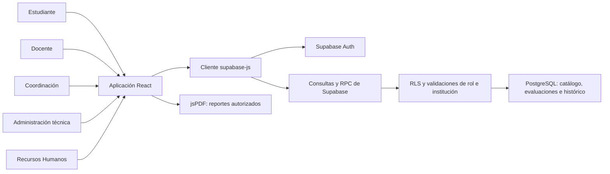

El bloque de RLS y validaciones representa controles dentro de PostgreSQL y sus funciones, no un servicio independiente. La administración técnica se limita a su institución; no se documenta un superadministrador global.

### Arquitectura por capas

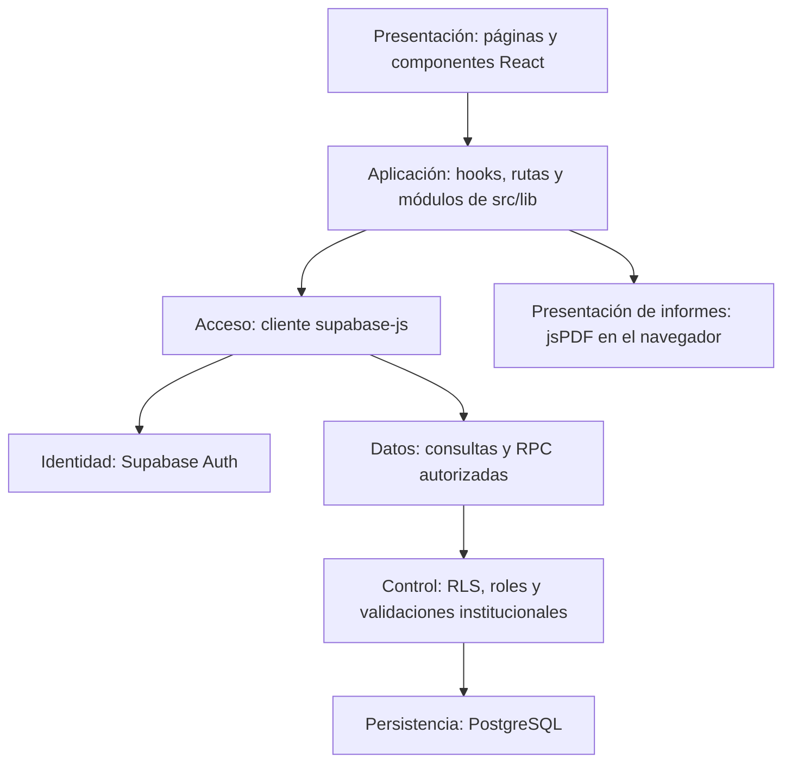

La separación muestra responsabilidades del código existente; no implica servicios o repositorios adicionales.

## 9. Tecnologías

| Tecnología | Uso confirmado en EvalDoc |
| --- | --- |
| React | Componentes, páginas y estado de la interfaz. |
| TypeScript | Tipos y comprobación estricta del frontend. |
| Vite | Servidor de desarrollo y compilación del cliente. |
| React Router | Rutas públicas, rutas por rol y redirecciones. |
| Tailwind CSS y estilos del proyecto | Base visual y hojas de estilo de las pantallas. |
| Lucide React e Inter | Iconos y tipografía de la interfaz. |
| @supabase/supabase-js | Sesión Auth, consultas permitidas y llamadas RPC. |
| Supabase Auth | Alta, correo confirmado, login, cierre y recuperación. |
| PostgreSQL y RLS | Persistencia, integridad, autorización por filas y funciones. |
| jsPDF | Generación bajo demanda de informes en el navegador. |
| Node.js y npm | Ejecución de herramientas, dependencias y pruebas. |
| Git y GitHub | Versionado y revisión del código mediante ramas y PR. |
| Docker Desktop y Supabase CLI | Servicios y migraciones de desarrollo local. |

Las dependencias de aplicación se contrastaron con package.json. Las gráficas actuales son componentes del proyecto; Recharts no figura entre las dependencias instaladas.

## 10. Estructura del proyecto

| Ruta real | Responsabilidad |
| --- | --- |
| src/auth/ | Contexto y proveedor de sesión, mensajes, recuperación y política de contraseña. |
| src/components/ | Layout, gráficas, formularios, evaluación y piezas de interfaz. |
| src/data/ | Datos y tipos auxiliares del frontend; no son la autoridad de permisos. |
| src/hooks/ | Carga de identidad y datos de estudiante, docente e institución. |
| src/lib/ | Clientes, contratos, validaciones, clasificación y modelos PDF. |
| src/pages/ | Vistas públicas y de los cinco roles. |
| src/routes/ | Guardia de rutas por rol. |
| src/styles/ | Estilos visuales y adaptación responsive. |
| src/types/ | Tipos de datos compartidos. |
| supabase/migrations/ | 13 migraciones SQL incrementales del esquema y funciones. |
| supabase/tests/ | Diez suites SQL de integridad, autorización y resultados. |
| tests/ | Pruebas Node de flujos, seguridad y reportes. |
| docs/ | Esquema, operación, validación y este documento maestro. |

## 11. Modelo de datos

El catálogo local confirma **20 tablas públicas**. Salvo las dos claves compuestas señaladas, cada PK es la columna id de tipo UUID. auth.users pertenece a Supabase Auth y no se cuenta como tabla pública de EvalDoc. El [diccionario de datos](data-dictionary.md) contiene los tipos, nulabilidad y restricciones de las 146 columnas públicas.

| Tabla | PK | Propósito, relaciones y datos principales |
| --- | --- | --- |
| institutions | id | Institución propietaria; name, short_name, slug y active. |
| campuses | id | Sede de institutions por institution_id; name, code y active. |
| profiles | id | Perfil 1:1 con auth.users.id y FK a institutions; full_name, institutional_email, institutional_identifier y status. |
| roles | id | Catálogo de códigos y nombres de rol. |
| user_roles | id | Vincula profile_id y role_id dentro de institution_id; UNIQUE impide repetir un mismo rol por perfil e institución. |
| academic_periods | id | Periodo institucional con name, starts_at, ends_at y active; el inicio debe preceder al fin. |
| programs | id | Carrera de institution_id, opcionalmente campus_id; name, code, active y catalog_visible. |
| subjects | id | Materia institucional, opcionalmente ligada a program_id; name, code y active. |
| groups | id | Grupo de subject_id en academic_period_id; code y active. |
| teaching_assignments | id | Docente teacher_id asignado a group_id en academic_period_id e institution_id. |
| student_enrollments | id | Alumno student_id inscrito en group_id, periodo e institución. |
| survey_templates | id | Plantilla institucional o global, con name, version y active. |
| survey_questions | id | Reactivo de survey_template_id; position, dimension, prompt, question_type, required y active. |
| evaluation_windows | id | Ventana de periodo y plantilla; starts_at, ends_at y active. |
| evaluations | id | Envío vinculado a student_id, teaching_assignment_id, ventana, periodo e institución; status y marcas de tiempo. |
| evaluation_answers | id | Respuesta privada de evaluation_id a question_id; numeric_value de 0 a 10 o text_value. |
| facilities | id | Instalación institucional o de campus; name, facility_type, description y active. |
| program_facilities | (program_id, facility_id) | Relación entre carrera e instalación, con created_at. |
| registration_requests | id | Solicitud de profile_id e institution_id; requested_role, campus_id, program_id, status, decided_by y decided_at. |
| registration_request_subjects | (request_id, subject_id) | Materias solicitadas y su institution_id; evidencia de onboarding, no permiso académico permanente. |

FK compuestas con institution_id —y, cuando corresponde, academic_period_id— bloquean relaciones entre instituciones o periodos incompatibles. Las restricciones UNIQUE previenen inscripciones, asignaciones y evaluaciones duplicadas; las ventanas y periodos tienen orden temporal válido. Los resultados de periodos diferentes permanecen como filas históricas, sin sobrescribir los anteriores.

## 12. Diagrama entidad–relación

El DER principal se divide en **A) núcleo académico** y **B) evaluaciones/registro** para conservar legibilidad. Entre ambos aparecen las 20 tablas públicas; algunas se repiten solo como contexto de las relaciones. auth_users representa conceptualmente auth.users, externa al esquema public. Algunas FK, como programs.campus_id, subjects.program_id y survey_templates.institution_id, son opcionales; las cardinalidades del dibujo no sustituyen las definiciones SQL.

### A) Núcleo académico

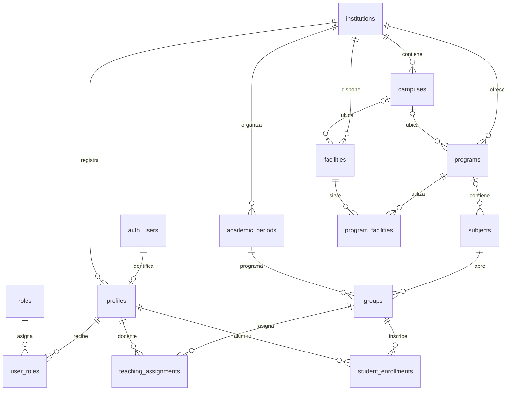

### B) Evaluaciones y registro

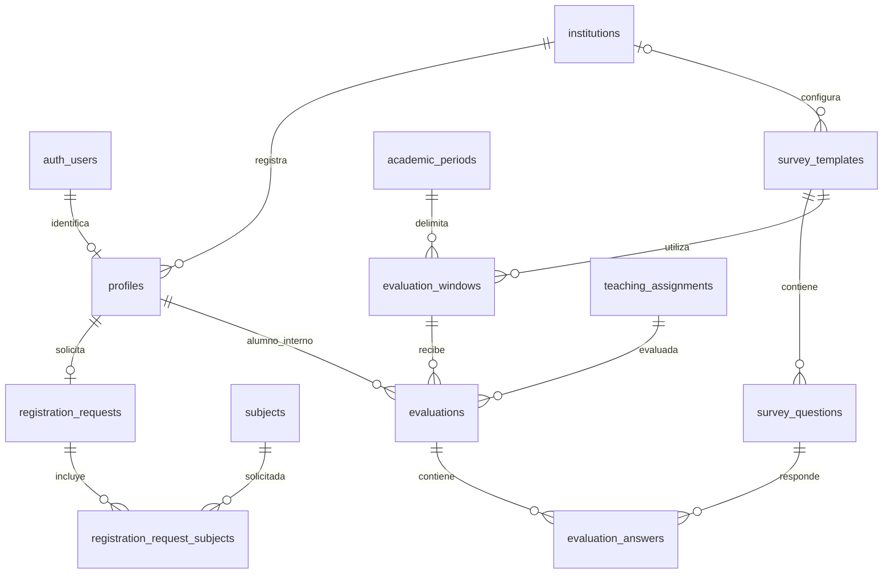

El [DER ampliado](database-er-diagram.md) y las migraciones detallan claves compuestas y relaciones institucionales que este gráfico omite para conservar legibilidad.

## 13. Catálogo académico

El catálogo público comprobado contiene **7 instituciones, 21 campus y 63 carreras activas visibles**: tres sedes por institución y tres carreras públicas por sede. La migración de gestión académica instala esa estructura; el seed conserva roles y plantilla oficial. Los programas QA históricos no se muestran como una carrera pública adicional. La migración posterior importa 189 materias, tres por carrera pública, sin crear inscripciones ni asignaciones.

La ruta conceptual es **Institución → Campus → Carrera → Materia → Grupo → Docente asignado / Alumno inscrito**. Materias y grupos se crean y administran desde Coordinación. Un grupo pertenece a una materia y un periodo; el campus se deriva de la carrera asociada a la materia. Al cambiar institución o sede en el registro, la UI limpia las selecciones descendientes incompatibles. Ningún solicitante escoge materias.

## 14. Registro y onboarding

El registro público presenta las instituciones activas aunque aún no tengan materias. Una selección académica inicial expresa una **solicitud**, no una inscripción ni una asignación. Supabase Auth valida credenciales y correo; el trigger crea un perfil pending y, para los tipos explícitos admitidos, una registration_request. No inserta user_roles antes de la aprobación.

| Solicitante | Selección inicial | Autoridad que decide |
| --- | --- | --- |
| Estudiante | Institución → campus → carrera pública → correo; sin materias. | Coordinación de la misma institución. |
| Docente | Institución → campus → correo; sin materias. | Coordinación de la misma institución. |
| Coordinador | Institución → solicitud sin programa ni materias → correo. | Admin técnico de la misma institución. |

El estudiante puede solicitar una cuenta para una carrera sin materias; el docente, para un campus sin materias o carreras. La ausencia de requested_subject_ids y una lista vacía son válidas. Las solicitudes nuevas no crean registration_request_subjects; las filas antiguas se conservan como evidencia. Admin y HR no pueden solicitarse por el registro público. Una alta directa de Auth sin requested_role queda pending sin rol ni solicitud. La [migración final de prevención](../supabase/migrations/20261011044815_prevent_legacy_student_autogrant.sql) eliminó el autogrant heredado. Dos cuentas QA anteriores conservaron usuario y perfil, pero se les retiró únicamente el rol prematuro en la base local; la comprobación final encontró cero perfiles pending con rol.

**Solicitud académica ≠ asignación real.** La aprobación activa el perfil y concede solo el rol solicitado permitido. No crea student_enrollments ni teaching_assignments. Las sedes, carreras y materias pedidas en solicitudes históricas siguen como evidencia; Coordinación puede decidir después otra inscripción o asignación válida de la **misma institución**, aunque difiera de la solicitud original.

## 15. Diagramas de registro y aprobación

### Registro de Estudiante

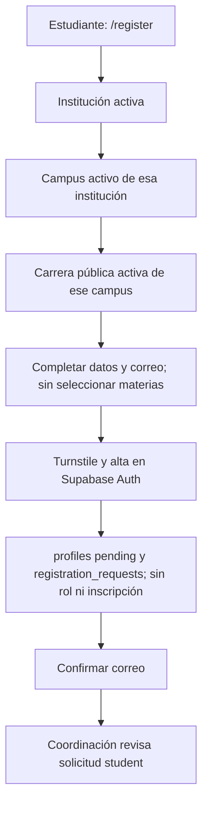

### Registro de Docente

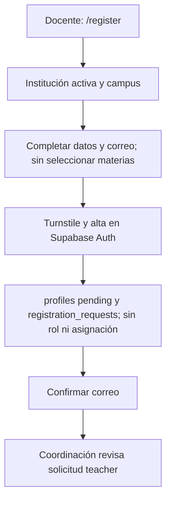

### Registro de Coordinador

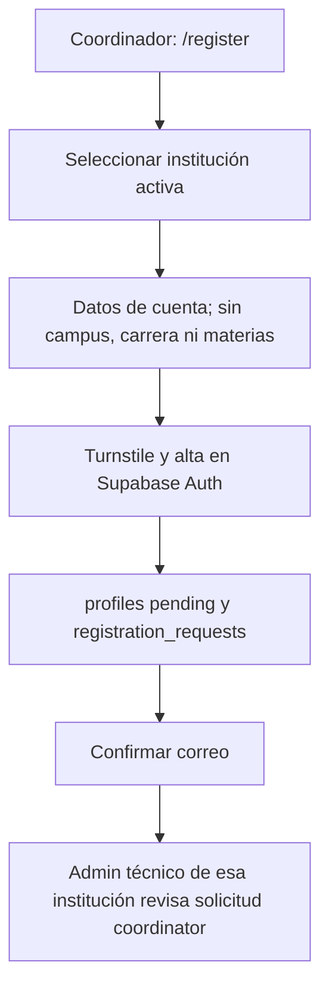

### Aprobación institucional

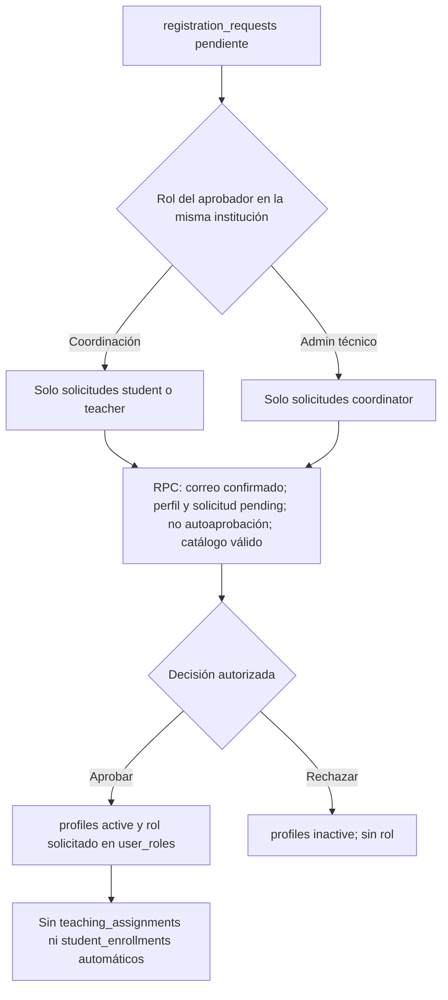

## 16. Autenticación

Login usa signInWithPassword; logout ejecuta signOut. AuthProvider restaura la sesión al recargar, escucha cambios de Auth y lee perfil y roles desde PostgreSQL. La prioridad visual si una persona tiene varios roles es admin → hr → coordinator → teacher → student. No es una regla RLS: cada RPC vuelve a verificar el rol requerido. RequireRole redirige a login si no hay sesión, a /pending si el perfil está pendiente y al inicio autorizado si el rol no coincide.

La confirmación de correo válida exige sesión y usuario confirmados; una URL con otp_expired, access_denied, error desconocido o enlace malformado no muestra «Correo confirmado». El perfil permanece pending aunque el correo ya esté confirmado. La contraseña local exige al menos ocho caracteres, mayúscula, minúscula, dígito y símbolo, con confirmación en registro y recuperación. Los formularios de registro, login y solicitud de recuperación integran Turnstile; el servidor Auth valida el token. Ni Coordinación ni Admin pueden consultar contraseñas de usuarios.

## 17. Recuperación de contraseña

/forgot-password solicita un enlace con resetPasswordForEmail y responde de manera neutral para no enumerar cuentas. Un enlace válido crea una sesión de recuperación; /reset-password comprueba el evento PASSWORD_RECOVERY o la coincidencia del token inicial con la sesión restaurada y valida el usuario. Tras updateUser, se cierra esa sesión y el usuario vuelve a login. Un enlace expirado, inválido o una sesión normal no abre el formulario.

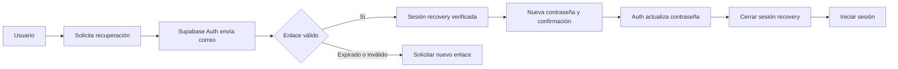

## 18. Roles y permisos

La tabla resume capacidades efectivas de las rutas y RPC actuales. «No» significa que ese rol por sí solo no recibe la capacidad; una persona multirrol puede tener otras facultades por un segundo rol válido. Admin técnico administra **su institución**, no todas las instituciones.

| Función | Student | Teacher | Coordinator | HR | Admin |
| --- | --- | --- | --- | --- | --- |
| Enviar evaluación propia elegible | Sí | No | No | No | No |
| Consultar resultados docentes propios agregados | No | Sí | No | No | No |
| Aprobar solicitudes student/teacher | No | No | Sí | No | No |
| Gestionar materias, periodos, grupos, asignaciones e inscripciones | No | No | Sí | No | No |
| Consultar analíticas institucionales generales | No | No | Sí | Sí | Sí |
| Ver ranking y desglose docente institucional publicable | No | No | Sí | Sí | No |
| Consultar indicadores específicos de HR | No | No | No | Sí | No |
| Aprobar solicitudes coordinator | No | No | No | No | Sí |
| Consultar resumen técnico y usuarios propios | No | No | No | No | Sí |
| Descargar reportes PDF autorizados | No | Propios | Institucionales | Institucionales | Generales |

La clasificación principal Contratable/Intermedio/No contratable se deriva en UI y reportes de resultados publicables. HR muestra además sus categorías operativas Excelente/Bueno/Suficiente/No Suficiente; ambas lecturas son indicadores de apoyo y no una decisión automática.

### Flujo general del sistema por roles

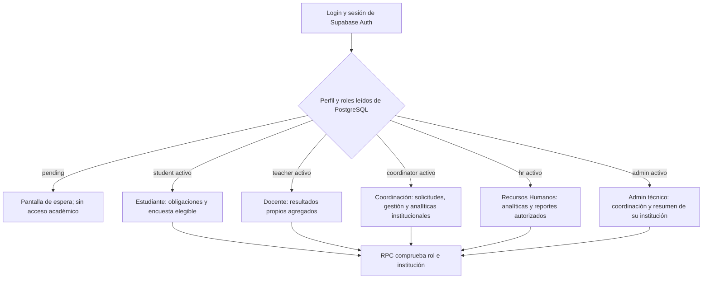

En cuentas multirrol, la ruta inicial usa la prioridad visual documentada; el permiso de cada operación se comprueba nuevamente en PostgreSQL.

## 19. Gestión académica

Desde /coordinator se consultan el catálogo y los usuarios activos de la propia institución. La selección institucional encadena campus, carrera, periodo, materia y grupo; después Coordinación elige el docente o estudiante. Coordinación puede crear periodos, crear o modificar materias de carreras públicas, crear y activar/desactivar grupos, asignar docentes e inscribir estudiantes mediante RPC específicas. La estructura de un grupo se comprueba por materia, programa, campus y periodo; el usuario debe tener perfil activo y rol docente o estudiantil adecuado dentro de la institución. Las FK y las comprobaciones RPC impiden referencias cruzadas; UNIQUE rechaza una segunda asignación o inscripción idéntica.

registration_requests y registration_request_subjects permanecen como evidencia del onboarding. No son autorización permanente para una materia o sede. Aprobar por sí solo no crea membresías. El catálogo incluye facilities y program_facilities para instalaciones/talleres, pero no existe una pantalla completa de alta y edición de esas entidades.

### Gestión académica: de institución a membresía real

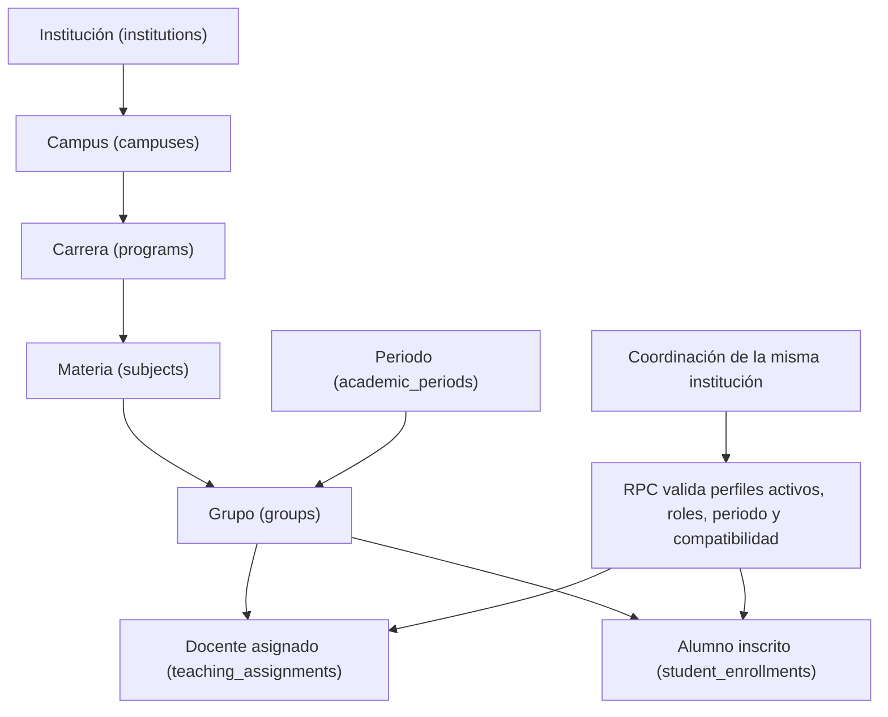

Las flechas de Coordinación representan operaciones posteriores a la aprobación, no efectos automáticos de registration_requests. `/student` consulta `my_student_enrollments()` para mostrar solo sus grupos reales, incluso antes de que exista una ventana de evaluación; un alumno aprobado sin inscripciones ve un estado vacío. `/teacher` consulta únicamente sus asignaciones reales y presenta un estado vacío si todavía no tiene ninguna.

## 20. Evaluación docente

El estudiante activo ve sus obligaciones mediante my_student_evaluations. El cuestionario carga exactamente 15 reactivos oficiales y acepta solo **0 Muy Deficiente; 2.5 Deficiente; 5 Regular; 7.5 Bueno; 10 Excelente**. La navegación recorre las preguntas y, tras la 15, abre una pantalla de revisión que indica 15/15. Allí se puede editar cualquier respuesta; contestar la última pregunta **no** escribe una evaluación.

El botón explícito «Enviar evaluación» abre la confirmación final. El control de envío evita dobles clics y reenvíos tras éxito. Solo entonces submit_evaluation verifica identidad, rol, inscripción, asignación, institución, periodo, ventana, plantilla y 15 respuestas válidas; guarda evaluación y respuestas de forma atómica. UNIQUE y un trigger previenen duplicados de la misma obligación alumno–docente–materia–periodo incluso entre ventanas o grupos. Después de un envío confirmado se muestra la pantalla de éxito; el alumno no obtiene acceso a respuestas individuales guardadas.

### Flujo completo de evaluación docente

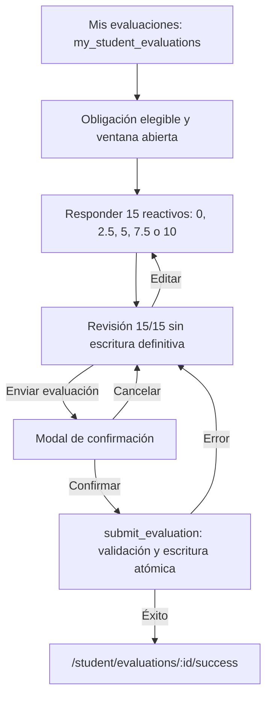

## 21. Privacidad y umbral de publicación

La unidad de publicación de puntuaciones es una **asignación docente con cinco o más evaluaciones completas**, cada una con 15 respuestas válidas. Con 0–4 evaluaciones se indica «Resultado protegido»: no se publican promedio, porcentaje favorable ni promedios por reactivo. Con cinco o más se publican únicamente los agregados autorizados. El sistema puede mostrar conteos de participación sin liberar una calificación protegida.

El student_id de evaluations se usa internamente para elegibilidad e integridad; no significa que la base desconozca al evaluador. La protección se aplica a lo que reciben el docente, Coordinación, HR, Admin y sus PDF: no se entregan respuestas individuales, nombres de alumnos asociados a respuestas ni lectura directa de evaluation_answers. Las consultas repetidas de agregados vivos durante una ventana abierta todavía pueden permitir inferencias por diferencias temporales; publicar cohortes cerradas sería un refuerzo futuro.

### Privacidad y umbral de cinco evaluaciones

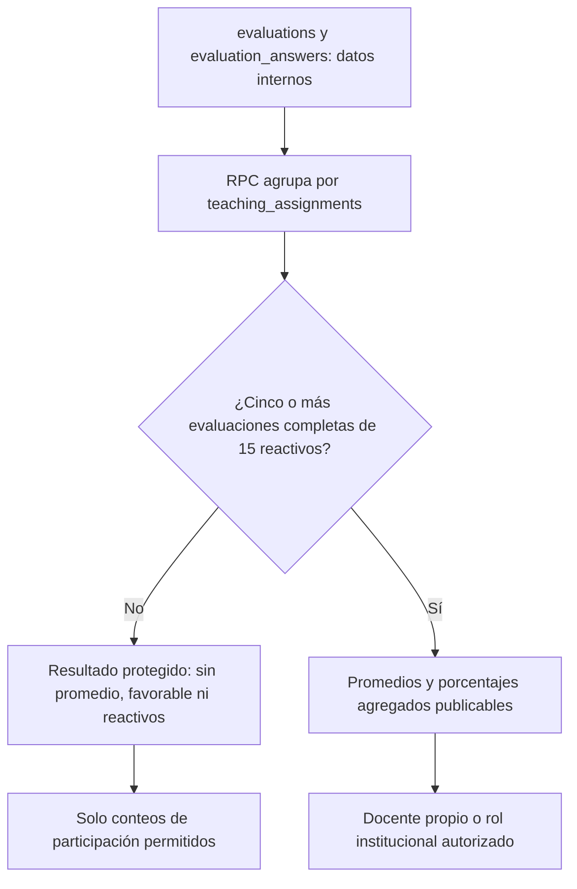

## 22. Resultados docentes

/teacher, /teacher/results/:id y /teacher/history consumen RPC de agregación de asignaciones propias. Presentan promedio general en escala 0–10, número de evaluaciones, resultados por dimensión o reactivo cuando son publicables, distribución favorable, evolución cronológica y comparación entre periodos. Las fortalezas y áreas de oportunidad se derivan de promedios publicados; no se inventan conclusiones si faltan datos o hay empate. Un UUID de asignación ajena no devuelve resultados.

El histórico pondera promedios de asignaciones publicables por el número de evaluaciones; no incorpora puntuaciones de grupos protegidos. El desglose por reactivo se oculta si distintas versiones de plantilla no son comparables. El PDF docente reutiliza esos agregados. Como **ejemplo exclusivamente QA local**, Profesora Laura Demo tiene 5 evaluaciones completas, 75 respuestas y promedio **8.7/10**; no son datos de producción.

## 23. Clasificación institucional

La regla única de clasificación general se implementa en src/lib/teacherClassification.ts sobre el promedio agregado **ya publicable**, sin persistir una segunda puntuación ni redondear antes de clasificar:

| Promedio válido de 0 a 10 | Clasificación |
| --- | --- |
| 8 ≤ promedio ≤ 10 | Contratable |
| 6 ≤ promedio < 8 | Intermedio |
| 0 ≤ promedio < 6 | No contratable |

Con menos de cinco evaluaciones completas de la asignación aparece **Resultado protegido**, sin categoría. Si un conteo publicable trae un promedio nulo, no finito o fuera de 0–10, aparece **Clasificación no disponible**; no se transforma en «No contratable». Laura, con 8.7 y cinco evaluaciones, se clasifica como **Contratable**. Ricardo, sin evaluaciones, no entra al ranking publicable. La vista HR conserva una categorización operativa distinta (Excelente, Bueno, Suficiente y No Suficiente) para su propio panel; no debe confundirse con esta regla general.

**La clasificación funciona como indicador de apoyo para la toma de decisiones institucionales y no determina automáticamente una decisión laboral.**

### Clasificación docente a partir del agregado publicable

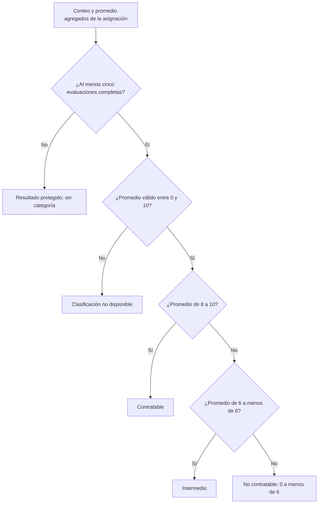

La categoría se calcula en la interfaz y los reportes; no se guarda como columna ni produce una decisión laboral automática.

## 24. Valoración favorable

**Promedio general ≠ valoración favorable.** El primero resume los valores numéricos en escala 0–10. La segunda expresa la proporción de respuestas publicables cuyo valor fue **7.5 o 10**:

**Valoración favorable (%) = respuestas con 7.5 o 10 ÷ total de respuestas publicables × 100.**

En el escenario QA de Laura, 68 de 75 respuestas cumplen esa condición: **68 ÷ 75 × 100 = 90.7 %**, mientras su **promedio general es 8.7/10**. No debe interpretarse el 90.7 % como una calificación sobre diez ni el 8.7 como un porcentaje.

## 25. Coordinación institucional

/coordinator reúne indicadores de participación, promedios publicables, tendencias, comparación de periodos, ranking y clasificación docente. Los filtros de periodo, campus, programa y grupo se obtienen del catálogo propio y se aplican de nuevo dentro de las RPC; no autorizan datos de otra institución. Coordinación puede revisar y decidir solicitudes student/teacher, pero no la propia ni una de otro tenant. Puede administrar materias, periodos, grupos, asignaciones e inscripciones y descargar los PDF institucionales autorizados.

Las decisiones de aprobación y las operaciones académicas son pasos distintos. La solicitud registra lo pedido; la asignación real se valida contra estructura y roles actuales de la institución. Admin técnico aprueba solicitudes de coordinator y consulta un resumen/usuarios propios; HR analiza indicadores y categorías sin gestionar la estructura académica. La UI no relaciona los nombres de alumnos mostrados en gestión de inscripciones con respuestas individuales.

## 26. Reportes PDF

Los PDF se generan **en el navegador** al solicitarse, sin almacenamiento de archivos en Supabase ni servicio de exportación. Antes de crear el archivo se consultan de nuevo los agregados autorizados. Los botones muestran carga/error y bloquean doble clic. Cada modelo omite identificadores estudiantiles y respuestas crudas.

| Informe | Acceso y contenido |
| --- | --- |
| Docente detallado | El propio docente: contexto de asignación, métricas y hasta 15 reactivos agregados cuando son publicables, histórico, clasificación y nota institucional. |
| Histórico docente | El propio docente: periodos, promedios publicables y clasificación por periodo. |
| Avance y participación | Coordinación, HR y Admin: obligaciones esperadas, realizadas, pendientes y tasas de participación autorizadas. |
| Ejecutivo institucional | Coordinación y HR: resumen, tendencia y desgloses o ranking publicables según su rol. Admin: resumen y tendencia generales, sin ranking ni reactivos. |

Los filtros elegidos acompañan al informe; en un histórico, el periodo seleccionado se identifica como referencia sin borrar los demás periodos de comparación. La clasificación y su advertencia figuran donde corresponde. jsPDF se carga bajo demanda. La generación local puede consumir memoria en informes extensos; no existe exportación Excel en esta entrega. La [matriz de informes](pdf-reports.md) precisa RPC y límites de cada modalidad.

### Generación de reportes PDF

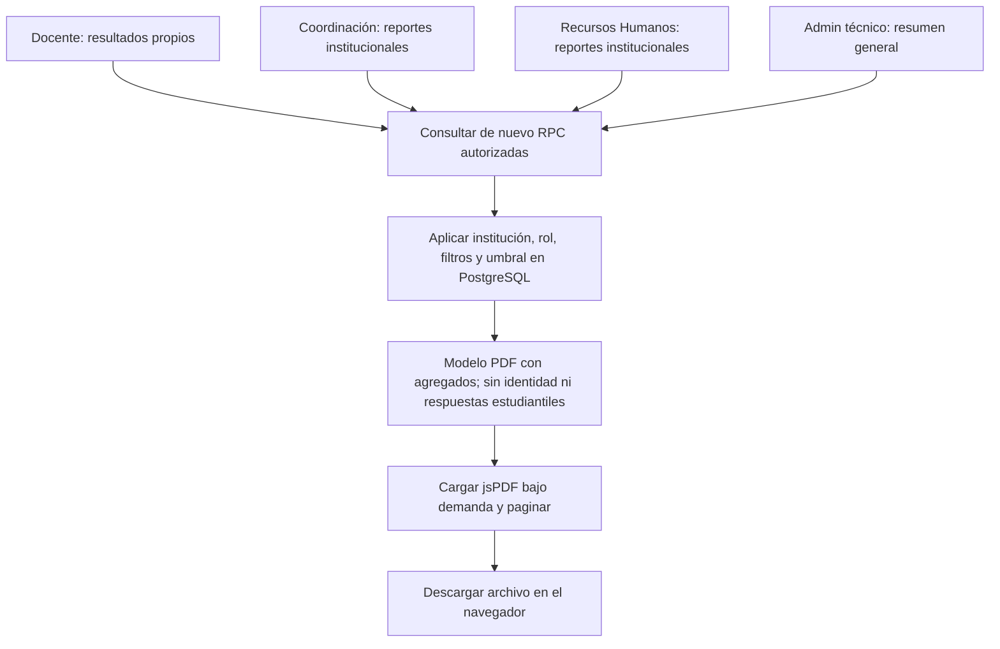

## 27. Seguridad

Las **20 tablas públicas tienen RLS activada** y el catálogo actual contiene **21 políticas**. Los roles y la institución se resuelven desde auth.uid(), profiles, roles y user_roles en PostgreSQL, no desde metadata editable, localStorage o un valor enviado por el navegador. El perfil debe estar activo para las operaciones académicas; la verificación global local de cierre QA halló **0 perfiles pending con rol**. Los filtros UUID y el institution_id de entrada nunca sustituyen la institución derivada de la sesión.

Las FK compuestas aseguran pertenencia institucional y compatibilidad de periodos; UNIQUE y triggers impiden duplicados y respuestas inválidas. La aprobación bloquea autoaprobación y decisiones entre instituciones. El frontend solo contiene variables públicas VITE_SUPABASE_URL, VITE_SUPABASE_ANON_KEY y VITE_TURNSTILE_SITE_KEY; ninguna clave service_role, contraseña de base o secret Turnstile pertenece al bundle. La site key de Turnstile es pública; su secret se configura únicamente para Auth.

La auditoría local de funciones encontró **40 SECURITY DEFINER** en public/app_private, todas propiedad de postgres, con search_path vacío y **0 ejecutables por anon o PUBLIC**. El permiso EXECUTE de authenticated en una RPC no basta por sí mismo: cada función autorizada verifica rol, perfil e institución. Las tablas evaluations y evaluation_answers no conceden lectura directa al cliente. La defensa combina guardas de navegación, grants, RLS, funciones, FK y restricciones; ninguna capa aislada se considera suficiente.

## 28. Diagrama de seguridad

```mermaid
flowchart LR
  USER["Usuario autenticado"] --> ROUTE["RequireRole: navegación"]
  ROUTE --> CLIENT["supabase-js con sesión"]
  CLIENT --> API["Consulta o RPC autorizada"]
  API --> ID["Validar auth.uid y perfil active"]
  ID --> ROLE["Resolver rol desde PostgreSQL"]
  ROLE --> TENANT["Comprobar institución y relaciones"]
  TENANT --> RLS["RLS, FK, UNIQUE y reglas de negocio"]
  RLS --> RESULT["Solo datos permitidos o agregado publicable"]
```

## 29. Migraciones

Las **15 migraciones** de supabase/migrations/ son incrementales. La tabla usa sus nombres reales; su orden numérico determina la evolución del esquema. Las migraciones antiguas no se reescriben para cambiar reglas posteriores.

| Migración | Propósito principal |
| --- | --- |
| 20260926071138_initial_evaldoc_schema.sql | Esquema inicial, 16 tablas base, tipos y relaciones académicas. |
| 20260926084254_auth_profiles_roles.sql | Vinculación de profiles con Auth y trigger de alta original. |
| 20261002215313_multiinstitution_rls.sql | RLS y lectura académica limitada por rol e institución. |
| 20261002223647_student_real_evaluations.sql | Elegibilidad, envío atómico y prevención de evaluaciones repetidas. |
| 20261002233352_teacher_aggregated_results.sql | Resultados e histórico docente agregados con umbral. |
| 20261003035132_institutional_aggregated_dashboards.sql | Participación, ranking y resúmenes institucionales por rol. |
| 20261003050927_institutional_analytics.sql | Tendencias, comparaciones, desgloses y analíticas de reactivos. |
| 20261003205436_program_facilities.sql | Instalaciones y relación N:M con programas. |
| 20261009204937_role_aware_registration.sql | Solicitudes de alta por rol y evidencia académica inicial. |
| 20261010082808_coordinator_account_recovery.sql | Solicitud/aprobación de coordinación y recuperación institucional. |
| 20261010090956_academic_catalog_management.sql | Catálogo 7/21/63 y RPC de gestión académica. |
| 20261010153000_teacher_assignment_context.sql | Campus y programa de la asignación propia del docente. |
| 20261011044815_prevent_legacy_student_autogrant.sql | Elimina autogrant student en altas sin requested_role. |
| 20261023192548_academic_subjects_catalog.sql | Incorpora 189 materias a 63 carreras públicas sin tocar QA. |
| 20261023201302_coordinator_controlled_enrollment.sql | Alta sin materias, aprobación segura y consulta de inscripciones propias. |

## 30. Pruebas y validación

La regresión final de PR #20 registró **103/103 pruebas Node**, **10/10 suites SQL**, **npm run lint PASS**, **npm run build PASS** y **git diff --check PASS**. Las diez suites SQL de supabase/tests/ cubren catálogo/gestión académica, recuperación de Coordinación, analíticas, dashboards, RLS multiinstitución, instalaciones, registro por rol, envío real del alumno, clasificación/reportes y resultados docentes. Sus fixtures se crean en transacciones que terminan en ROLLBACK; no requieren eliminar el escenario QA. Las pruebas Node incluyen Auth local, confirmación y recuperación, Turnstile, registro, escala, revisión/envío explícito, clasificación, privacidad y PDF.

Para PR #25, la migración incremental se ensayó junto con 22 aserciones SQL en una transacción con ROLLBACK y luego se aplicó solo a Supabase local. Pasaron 12/12 suites SQL con ROLLBACK y 104/104 pruebas Node; lint, build y diff-check también pasaron. El escenario QA conservó 12 usuarios Auth, 7 instituciones, 21 campus, 63 carreras públicas, 189 materias importadas más dos QA, cinco evaluaciones, 75 respuestas y promedio 8.7/10. No se ejecutó db reset ni se modificó Supabase remoto.

Estas cifras son evidencia de **validación local**, no pruebas de carga ni certificación de producción. La compilación pasó con la advertencia conocida de un chunk inicial superior a 500 kB. La [validación final](final-validation.md) distingue el estado PR #20 de evidencias históricas de etapas anteriores.

## 31. QA visual final

La revisión autenticada documentada en PR #20 usó cuentas QA existentes, sin cambiar contraseñas ni crear usuarios permanentes. Se observaron anchos de **375, 768 y 1440 px** en /student, /teacher, /teacher/history, detalle /teacher/results/:id, /coordinator, /institutions y /admin. No se detectó desbordamiento horizontal de página ni errores de consola; las tablas amplias usan desplazamiento interno. Se comprobaron controles, filtros, clasificación, gestión académica y botones PDF visibles. La ruta HR se cubre por código y pruebas de permisos, pero no se atribuye a esa revisión visual autenticada.

Los datos QA son ejemplos de funcionamiento local, **no resultados de una institución en producción**. La verificación final conservó 12 usuarios Auth locales, 7 instituciones, 21 campus, 63 carreras públicas, cinco evaluaciones y 75 respuestas; Laura mantuvo 8.7/10, Ricardo 0 evaluaciones y Pedro su inscripción en QA-BIOT-101.

## 32. Instalación local en Windows

Se necesitan Git, Node.js con npm, Docker Desktop en ejecución y acceso al repositorio. Supabase CLI está declarada como dependencia de desarrollo; se invoca mediante npx.cmd. Para una **instalación nueva**, sin datos locales que conservar:

```powershell
git clone https://github.com/BetoGuzmanBarrera/evaldoc.git
Set-Location evaldoc
npm.cmd install
Copy-Item .env.example .env.local
npx.cmd supabase start
npm.cmd run dev
```

Antes de iniciar la aplicación, completar .env.local con la URL local de Supabase, su **anon key pública** y la site key pública de Turnstile; obtenerlas del propio entorno local sin copiarlas a este documento ni versionarlas. La secret de Turnstile pertenece al .env local ignorado y a la configuración de Auth, nunca a una variable VITE_. El [README](../README.md) y la [guía Turnstile](turnstile-antibot.md) describen la configuración local y el seed. La primera inicialización requiere comprobar que se aplicaron migraciones y seed. **No ejecutar db reset en una instalación con QA o datos que deban conservarse.**

En PowerShell, la política de ejecución puede bloquear npm.ps1 o npx.ps1; npm.cmd y npx.cmd son alternativas directas. Para validar una instalación de pruebas: npm.cmd run test, npm.cmd run lint y npm.cmd run build. Las suites locales de Auth/Turnstile crean fixtures temporales y requieren verificar el proyecto y puerto correctos antes de ejecutarse.

## 33. Ejecución y direcciones locales

Las direcciones se basan en la configuración local versionada y en la ejecución QA documentada; no son dominios públicos.

| Servicio | URL local |
| --- | --- |
| Aplicación Vite | http://localhost:5173 |
| API y Auth de Supabase EvalDoc | http://127.0.0.1:55421 |
| Supabase Studio | http://127.0.0.1:55423 |
| Mailpit | http://127.0.0.1:55424 |

## 34. Despliegue

La entrega está validada **solo en localhost**. Para producción se requiere un proyecto Supabase remoto dedicado, dominio HTTPS, configuración de variables públicas y secretos por separado, correo transaccional real, Turnstile de producción, redirects Auth exactos, carga académica autorizada y pruebas por rol en staging. También hacen falta respaldo y restauración comprobados, política de retención de respuestas, aviso de privacidad, monitoreo sin tokens o datos sensibles y revisión de las 21 políticas y RPC sobre el entorno de destino.

Nada de ello se declara desplegado. Un despliegue debe seguir el [runbook de producción](production-deployment.md) y aprobación operativa separada; no se debe aplicar un reset a una base con datos. La compatibilidad de PostgreSQL y el orden de las 13 migraciones se comprueban antes de cualquier cambio remoto.

## 35. Mantenimiento

Los cambios de esquema se realizan mediante **nuevas migraciones incrementales** y revisión del diff; no se editan migraciones ya aplicadas. Antes de integrar una rama se ejecutan las suites SQL y Node, lint, build y revisión de Git. El flujo de Git/GitHub conserva ramas y PR revisables, sin convertir los datos QA locales en seed de producción.

Las claves privilegiadas y contraseñas permanecen fuera de Git y de variables VITE_. Es necesario revisar periódicamente RLS, grants, funciones SECURITY DEFINER, dependencias, errores de Auth y límites de privacidad. Los informes y métricas deben recalcularse o versionarse con cuidado si cambia la plantilla de 15 reactivos.

## 36. Limitaciones reales

El entorno de entrega es local. El catálogo de 63 carreras no viene acompañado de materias precargadas masivamente; Coordinación debe configurarlas. La UI tampoco administra por completo campus, carreras o instalaciones. El build conserva una advertencia de chunk superior a 500 kB. Los PDF grandes consumen memoria del navegador. El umbral de cinco reduce exposición, pero no elimina inferencias por comparaciones temporales de agregados. Las categorías docentes son indicadores, no automatizan decisiones laborales. Producción exige configuración, gobierno de datos y validación adicional.

## 37. Trabajo futuro

Como trabajo posterior, sujeto a aprobación, cabe dividir el bundle inicial, desplegar en un entorno institucional con dominio y correo reales, configurar Turnstile de producción, ampliar auditoría y monitoreo, establecer publicación por cohortes cerradas, incorporar procedimientos de backup/retención y valorar otras exportaciones. Estas posibilidades **no** forman parte de las funciones actuales ni de la validación local reportada.

## 38. Conclusiones

EvalDoc reúne el ciclo principal de evaluación docente: registro y aprobación institucional, asignación académica separada, envío elegible y único, publicación agregada, seguimiento histórico y reportes. La autorización combina rutas, sesión, roles de base, RLS, RPC e integridad relacional, con aislamiento entre instituciones. El umbral de publicación protege resultados de grupos pequeños sin afirmar anonimato absoluto frente a toda inferencia posible.

El proyecto cumple su alcance funcional académico y cuenta con pruebas y revisión local documentadas. Su clasificación interpreta resultados publicables como apoyo a responsables humanos. La transición a datos institucionales reales requiere las decisiones de despliegue y privacidad descritas arriba; la entrega actual queda preparada para evaluación académica, no se presenta como servicio productivo.

## 39. Referencias técnicas

Las referencias siguientes son documentación oficial de las tecnologías utilizadas; las cifras y capacidades específicas de EvalDoc provienen del repositorio, las migraciones y la base local, no de estas guías generales.

- [React — Learn React](https://react.dev/learn).
- [TypeScript — Documentation](https://www.typescriptlang.org/docs/).
- [Vite — Getting Started](https://vite.dev/guide/).
- [React Router — Routing](https://reactrouter.com/start/declarative/routing).
- [Supabase — Use Supabase with React](https://supabase.com/docs/guides/getting-started/quickstarts/reactjs).
- [Supabase — Auth](https://supabase.com/docs/guides/auth).
- [Supabase — Row Level Security](https://supabase.com/docs/guides/database/postgres/row-level-security).
- [Supabase — CLI local](https://supabase.com/docs/guides/local-development/cli/getting-started).
- [PostgreSQL 17 — Documentation](https://www.postgresql.org/docs/17/).
- [Mermaid — diagramas entidad–relación](https://mermaid.js.org/syntax/entityRelationshipDiagram.html).
